<p align="center">
  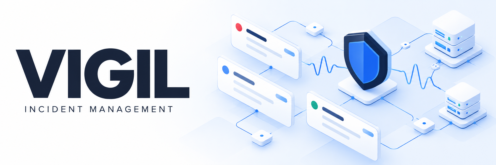
</p>

# Vigil

Vigil is a web app for handling IT incidents. Users report problems, administrators assign them, and technicians track the work through to resolution.

The local Docker setup is ready. Deployments to Azure and AWS and a CI/CD pipeline are planned.

**Contents**

[What works today](#features) · [The app](#preview) · [Incident workflow](#workflow) · [Architecture](#architecture) · [Database](#database) · [Run locally](#getting-started) · [JUnit tests](#tests) · [Azure, AWS and CI/CD](#roadmap)

<a id="features"></a>
## 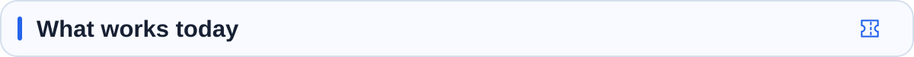

| Area | What you can do |
| --- | --- |
| Accounts | Register and sign in with JWT authentication. Three roles control access; passwords are hashed with BCrypt. |
| Incidents | Report a problem, assign a technician, and search or filter by status, severity and category. |
| Dashboard | Check incident counts, priorities, trends and technician workloads through cards and charts. |
| Comments and exports | Technicians and administrators can add comments. Export an incident as a PDF or a list as CSV. |
| Users and audit | Change roles, enable or disable accounts, and see who made each change. |
| Email alerts | Notify administrators about a critical incident or a threshold of at least three active high-severity incidents. |

<a id="preview"></a>
## 

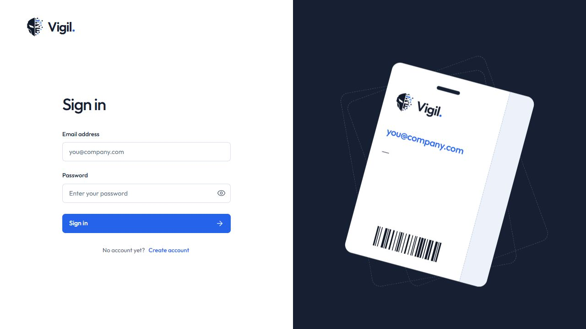

The sign-in screen from the local frontend. After signing in, users see their own incidents. Technicians see their assigned work and a dashboard; administrators can also manage users and view audit logs.

<a id="workflow"></a>
## 

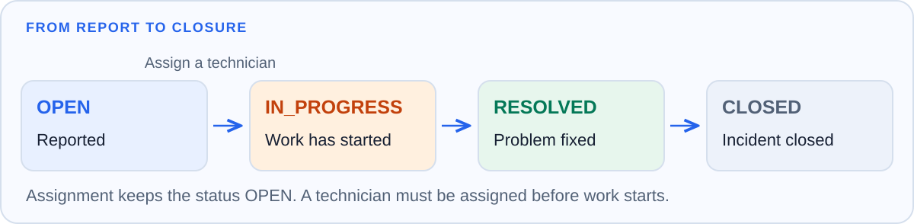

A user or administrator reports a problem. An administrator assigns a technician, who starts work, resolves the incident and closes it. Administrators can also perform these status changes.

The API enforces the order: work starts after assignment, an incident must be in progress before it can be resolved, and it must be resolved before it can be closed. Status changes are recorded in the audit log.

<a id="architecture"></a>
## 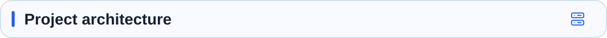

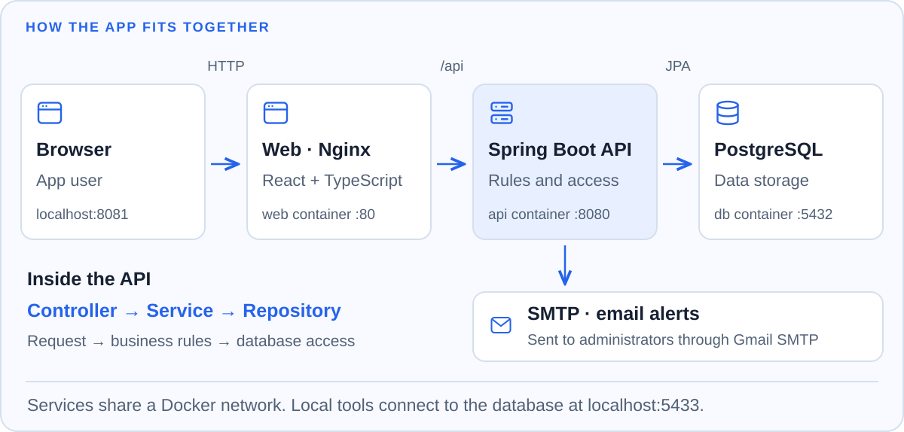

The frontend displays data and sends requests to the API. The API checks permissions and handles the work; PostgreSQL stores the data. Nginx serves the frontend and forwards `/api` requests to the backend.

| Layer | Technologies and purpose |
| --- | --- |
| Web | React 19, TypeScript 6 and Vite 8, with Recharts for charts and React PDF for exports. |
| API | Java 25 and Spring Boot 4.1, with Spring Security, JWT, validation and Spring Mail. |
| Data | PostgreSQL 18 and Spring Data JPA for reading and storing records. |
| Local setup | Docker Compose connects the database, API and Nginx frontend. Swagger documents the API. |

Inside the API, controllers receive requests, services apply business rules, and repositories access the database. Dashboard statistics are currently calculated in the frontend from API responses.

<details>
<summary><strong>Where is the code?</strong></summary>

```text
vigil/
├── vigil-web/src/
│   ├── pages/           Application screens
│   ├── components/      UI components
│   ├── api/             Backend requests
│   └── services/        Session, statistics and exports
├── vigil-api/src/
│   ├── main/java/com/vigil/api/
│   │   └── auth, user, incident, comment, audit, notification
│   └── test/java/       JUnit tests
├── docs/readme/         Illustrations, diagrams and screenshot
└── compose.yaml         Local Docker setup
```

</details>

<a id="database"></a>
## 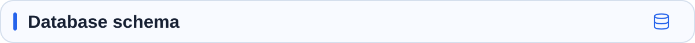

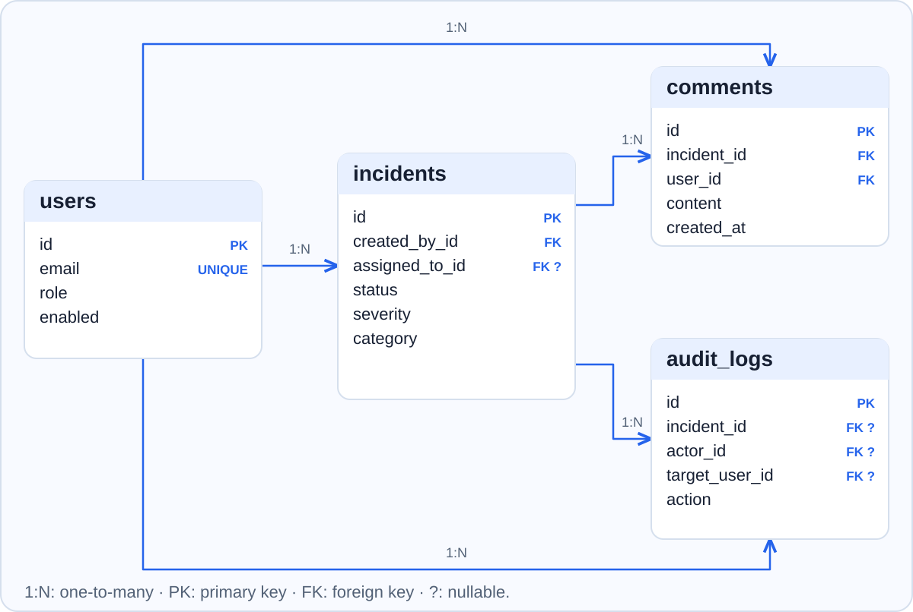

Each incident has a reporter and can have an assigned technician. A comment belongs to an incident and its author. Audit entries record who made a change and can reference an incident or a target user.

User roles, incident statuses, severities and categories are stored as enum names. Email addresses are unique. An audit entry can have no incident because account changes are logged too.

<details>
<summary><strong>Columns in each table</strong></summary>

| Table | Columns |
| --- | --- |
| `users` | `id`, `email`, `password_hash`, `first_name`, `last_name`, `role`, `enabled`, `created_at` |
| `incidents` | `id`, `title`, `description`, `severity`, `status`, `category`, `created_by_id`, `assigned_to_id`, `created_at`, `updated_at`, `resolved_at` |
| `comments` | `id`, `incident_id`, `user_id`, `content`, `created_at` |
| `audit_logs` | `id`, `incident_id`, `actor_id`, `action`, `target_user_id`, `previous_role`, `new_role`, `created_at` |

Each `id` is an automatically generated primary key. `assigned_to_id` and `resolved_at` are nullable. In `audit_logs`, `incident_id`, `actor_id`, `target_user_id`, `previous_role` and `new_role` are nullable; the role fields hold the before and after values for a role change. All other listed columns are required.

</details>

<a id="getting-started"></a>
## 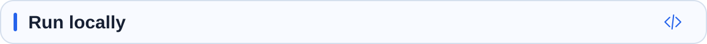

Install JDK 25 and Node.js 22.12+, and start Docker Desktop with Linux containers. The Maven Wrapper is included.

Run the commands below in PowerShell from the repository root.

**1. Set up the environment files.** Copy the examples if you do not already have local `.env` files:

```powershell
Copy-Item .env.example .env
Copy-Item vigil-api/.env.example vigil-api/.env
Copy-Item vigil-web/.env.example vigil-web/.env
```

Edit these values before starting the app:

| File | Setting |
| --- | --- |
| `.env` and `vigil-api/.env` | Use the same `DB_PASSWORD` in both files. |
| `vigil-api/.env` | Set a random `JWT_SECRET` of at least 32 ASCII characters. For email alerts, enter `MAIL_USERNAME` and a Gmail `MAIL_APP_PASSWORD`. |
| `vigil-web/.env` | Keep `VITE_API_BASE_URL=/api`. The example includes the other local settings. |

**2. Build the apps and Docker images, then start the services.**

```powershell
Push-Location vigil-api
.\mvnw.cmd clean package -DskipTests
Pop-Location

Push-Location vigil-web
npm.cmd ci
npm.cmd run build
Pop-Location

docker build -t vigil-api:local ./vigil-api
docker build -t vigil-web:local ./vigil-web
docker compose up -d
```

| Address | Purpose |
| --- | --- |
| [localhost:8081](http://localhost:8081) | Open the app and create an account. |
| [localhost:8080/swagger-ui/index.html](http://localhost:8080/swagger-ui/index.html) | Read the API documentation and try requests. |
| `localhost:5433` | Connect to PostgreSQL from local tools and tests. |

<details>
<summary><strong>Create the first local administrator</strong></summary>

Registration creates a `USER` account. To set up the first local administrator, register an account, replace the email below with yours, and run:

```powershell
docker compose exec db psql -U vigil_api_user -d vigil_db -c "UPDATE users SET role = 'ADMIN' WHERE email = 'your@example.com';"
```

Sign out and back in. You can then assign the `TECHNICIAN` role to other accounts on the Users screen.

</details>

Check service status with `docker compose ps` and API logs with `docker compose logs api`. Stop the app with `docker compose down`. Database records stay in the Docker volume.

<a id="tests"></a>
## 

The backend has JUnit Jupiter tests using Mockito, MockMvc and Spring Boot. They cover:

- Registration, authentication and access permissions for each role.
- Incident assignment, allowed status changes, comments, audit records and email alerts.
- Role changes, account activation and deactivation, and restrictions on managing technicians with active assignments.

[`vigil-api/src/test/java`](vigil-api/src/test/java) contains service tests, HTTP access tests and integration tests against a real database.

```powershell
Push-Location vigil-api
.\mvnw.cmd test
Pop-Location

Push-Location vigil-web
npm.cmd run lint
npm.cmd run build
Pop-Location
```

The full backend suite needs PostgreSQL running. Set `DB_URL=jdbc:postgresql://localhost:5433/vigil_db` in `vigil-api/.env` for local tests. Frontend checks use the linter and TypeScript/Vite build.

<a id="roadmap"></a>
## 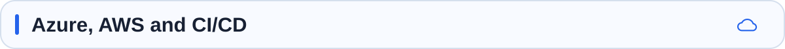

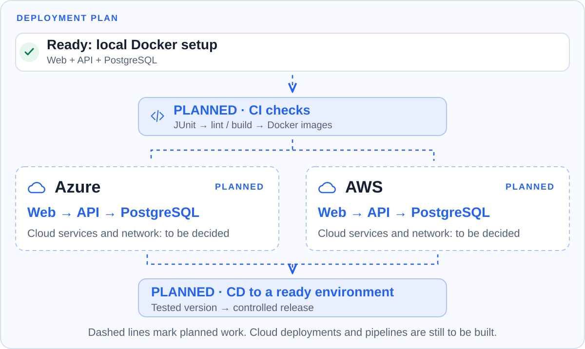

We plan to deploy Vigil to Azure and AWS. The specific cloud services and network setup are still to be decided.

| Step | Planned work |
| --- | --- |
| CI, before or alongside the first deployment | Run JUnit tests, frontend lint/build and Docker builds automatically. Give integration tests their own database. |
| Azure and AWS deployment | Host the web app, API and PostgreSQL with HTTPS and secure secret storage. |
| CD, once the environment is ready | Deliver tested Docker images through a controlled release process, with a way to roll back. |

CI (continuous integration) checks the build and tests when code changes. CD (continuous delivery) automates delivery of a tested version. Cloud deployments and these pipelines have not been implemented yet.
